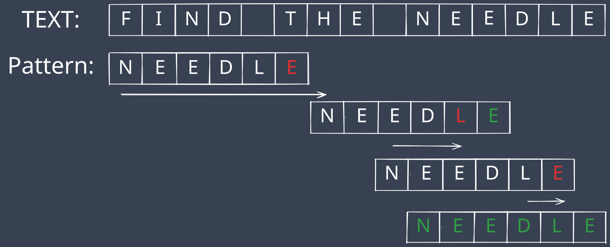
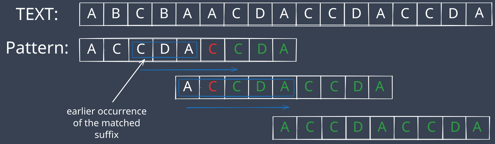

+++
author = "Damian Kuraś"
title = "Efficient Text Search Algorithms in C++: Boyer-Moore Algorithm" 
date = 2024-11-12
lastmod = 2024-11-12
description = "Learn how the Boyer-Moore algorithm text search algorithm works and how to implement in C++." 
draft = false
image = "images/bm-text-search-cover.png"
keywords = "Boyer-Moore algorithm, text search in C++"
categories = ["Algorithms"]
tags = ["C++","Search"]
slug = "boyer-moore-text-search"
math = false
+++

## Introduction

The Boyer–Moore algorithm is a powerful tool for text searching, especially useful in applications where efficiency matters. Developed by **Robert S. Boyer** and **J Strother Moore** in 1977 [original paper](https://www.cs.utexas.edu/~moore/publications/fstrpos.pdf), this algorithm significantly outperforms naive string matching techniques by leveraging two key optimization rules that allow it to skip over large portions of text.

## How the Boyer-Moore Algorithm Works

The Boyer-Moore algorithm compares the pattern and text starting from the end of the pattern, which helps in skipping over large sections of text. This is a stark contrast to naive methods that compare characters from the beginning.


The Boyer–Moore algorithm uses two main rules to increase its efficiency:

1. **The Bad Character Rule**
2. **The Good Suffix Rule**

These rules help determine how far the search can skip ahead, optimizing performance. With these, the worst-case time complexity is **_O_(n\*m)**, but in most cases, it performs much faster, especially when the pattern is not found, or we need only an index of the first occurrence of a pattern in text, its time complexity is O(n+m).

To apply these rules, we need to create lookup tables based on the pattern.

## The Bad Character rule

The Bad Character Rule helps us decide how far we can shift the pattern to the right after a mismatch, allowing us to skip unnecessary comparisons. Here's how it works:

**Mismatch Detection:**
The algorithm starts comparing from the end of the pattern. When a mismatch occurs, it checks if the mismatched character exists elsewhere in the pattern.

**Finding the Last Occurrence:**
If the mismatched character appears elsewhere in the pattern, the pattern is shifted to align the last occurrence of the mismatched character with the text character. This avoids unnecessary re-checks of already compared characters.

**If No Match is Found:**
If the mismatched character doesn’t appear in the pattern, the algorithm skips past the mismatched character entirely, maximizing the shift distance.



## The Good Suffix rule

The Good Suffix Rule allows us to skip parts of the text when a suffix of the pattern (a portion of characters at the end) matches part of the text but is followed by a mismatch. When this happens, the rule finds where this suffix occurs earlier in the pattern.

**Find Earlier Occurrence:**
If there's an earlier occurrence of the suffix in the pattern, shift the pattern so this occurrence aligns with the matched part in the text.

**Shift to the Longest Prefix:**
If there's no such earlier occurrence, shift the pattern so that the longest prefix of the pattern matches the suffix in the text.



## Visualization



## Implementation in c++.

Return the indexes of all occurrences of the pattern in the text.

```cpp
#include <iostream>
#include <vector>
#include <string>
#include <unordered_map>
#include <algorithm>

using namespace std;

void createBadCharacterTable(const string &pattern,
                             unordered_map<char, int> &badCharShift)
{
    int m = pattern.size();
    for (int i = 0; i < m; ++i)
    {
        badCharShift[pattern[i]] = i;
    }
}

void createGoodSuffixTable(const string &pattern, vector<int> &goodSuffixShift)
{
    int m = pattern.size();
    vector<int> borderPos(m + 1, 0);
    int i = m, j = m + 1;
    borderPos[i] = j;

    while (i > 0)
    {
        while (j <= m && pattern[i - 1] != pattern[j - 1])
        {
            if (goodSuffixShift[j] == 0)
            {
                goodSuffixShift[j] = j - i;
            }
            j = borderPos[j];
        }
        --i;
        --j;
        borderPos[i] = j;
    }

    for (int k = 0; k <= m; ++k)
    {
        if (goodSuffixShift[k] == 0)
        {
            goodSuffixShift[k] = j;
        }
        if (k == j)
        {
            j = borderPos[j];
        }
    }
}

vector<int> boyerMoore(const string &text, const string &pattern)
{
    int n = text.size();
    int m = pattern.size();
    unordered_map<char, int> badCharShift;
    vector<int> goodSuffixShift(m + 1, 0);
    vector<int> matchPositions;
    createBadCharacterTable(pattern, badCharShift);
    createGoodSuffixTable(pattern, goodSuffixShift);

    int i = 0;
    while (i <= n - m)
    {
        int j = m - 1;

        while (j >= 0 && pattern[j] == text[i + j])
        {
            --j;
        }

        if (j < 0)
        {
            matchPositions.push_back(i);
            i += goodSuffixShift[0];
        }
        else
        {
            int badCharShiftValue = j - badCharShift[text[i + j]];
            int goodSuffixShiftValue = goodSuffixShift[j + 1];
            i += max(1, max(badCharShiftValue, goodSuffixShiftValue));
        }
    }

    return matchPositions;
}
```

## Conclusion: Why the Boyer-Moore Algorithm is Essential

The **Boyer-Moore algorithm** is widely used in C++ libraries (since C++17) and is also featured in popular tools like GNU grep. Chances are, you've used it yourself when performing text searches on your computer. Its combination of the **Bad Character** and **Good Suffix** rules makes it an optimal choice for many text searching tasks.

You can check my previous post about Knuth-Morris-Pratt algorithm [here]( )
