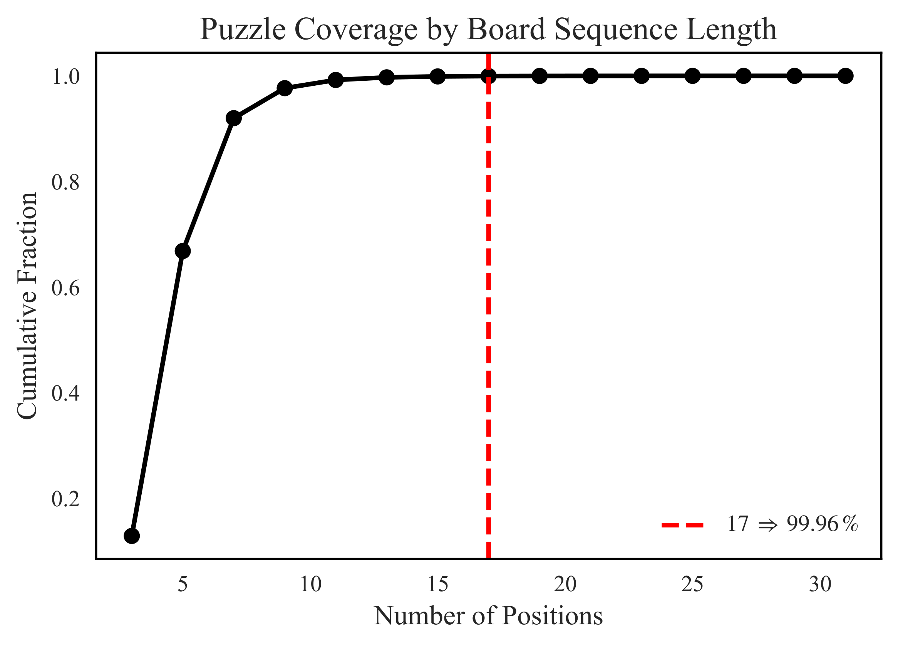
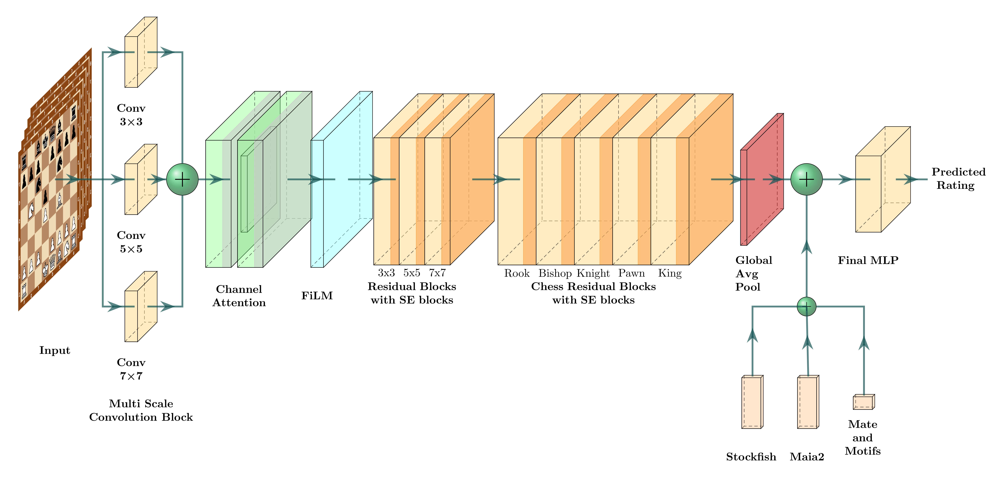
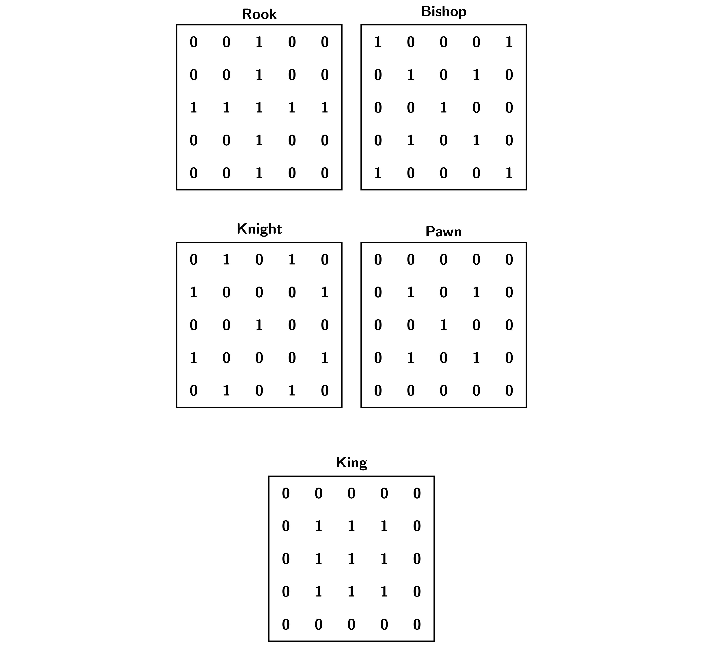

+++
author = "Damian Kuraś"
title = "Predicting Chess Puzzle Difficulty with Deep Learning" 
date = 2026-03-31
lastmod = 2026-03-31
description = "My journey building a deep learning architecture for chess puzzle difficulty prediction placing 10th at FedCSIS 2025." 
draft = false
image = "images/pexels-tugce-acikyurek-3099881-16253624.jpg"
keywords = "chess, machine learning, deep learning, PyTorch, CNN, uncertainty quantification, FedCSIS"
categories = ["Machine Learning", "Deep Learning", "Projects"]
tags = ["Python", "PyTorch", "Computer Vision", "AI"]
slug = "chess-puzzle-difficulty-prediction"
math = true
+++

## Introduction

Can a machine understand how hard a chess puzzle is for a human?

This was the exact premise of the Predicting Chess Puzzle Difficulty challenge at FedCSIS 2025. The competition involved taking millions of chess puzzles and predicting their Glicko-2 difficulty rating. Modern chess engines can easily evaluate if a position is winning, but the real difficulty lies in quantifying human error. Why do people miss certain moves, and what tactical patterns are the hardest to spot?

For my submission (Team Feiwyth), I treated chess move sequences as spatio-temporal data (essentially, a series of "snapshots" unfolding over time) and built a convolutional neural network architecture using custom piece-movement masking. This approach led to me **placing 10th** in the main prediction task and **2nd** in the Uncertainty Quantification challenge.

Here is an overview of the model architecture and the feature engineering pipeline I used to achieve these results.

[<button>View the Code on GitHub</button>](https://github.com/DamianKuras/chess-puzzle-rating-predictor)

## Data Representation: Turning Chess into Tensors

To train a deep neural network efficiently, you first need a good representation of the board state. Modern engines like AlphaZero use complex multi-plane bitboards, but I needed something that was memory-efficient and sequential, since puzzles are solved over a series of moves.

I encoded each board position as 12 binary $8 \times 8$ bitboards (think of these as independent grids of 1s and 0s mapping exactly where each specific piece type is located). Because a puzzle is a sequence of positions, the temporal dimension is crucial. When analyzing the dataset, I found that truncating the move sequences to a maximum of 17 positions retained 99.96% of the puzzle data. This dramatically reduced memory usage during training without sacrificing information. 

*Tracking the probability curve to identify the optimal 17-ply truncation threshold.*

Shorter sequences were zero-padded to ensure consistent input dimensions, flattening from a shape of `17 x 12 x 8 x 8` into `204 x 8 x 8` before going into the first convolution.

## The Core Architecture: A PyTorch Implementation

I built the main architecture using standard **PyTorch** and **PyTorch Lightning**. My workflow involved separating the spatial feature extraction, channel refinement, and auxiliary feature fusion into distinct modular blocks.

*A high-level overview of the feature extraction pipelines and fusion layer.*

### Multi-Scale Convolution Block
Instead of a standard single-scale convolution, my initial layer extracts patterns at different resolutions simultaneously. It employs three parallel 2D convolution layers with kernel sizes of $3 \times 3$, $5 \times 5$, and $7 \times 7$. Their outputs are concatenated. Think of this as giving the AI multiple lenses: it simultaneously uses a "magnifying glass" to capture immediate tactical squabbles, and "binoculars" to spot longer-range piece coordination right from the input layer.

### Feature-wise Linear Modulation (FiLM)
Typically, chess models concatenate the side-to-move (White/Black) as a separate input plane. I wanted something more parameter-efficient that propagated the playing perspective deeper into the network. 

To do this, I implemented a Feature-wise Linear Modulation (FiLM) layer. FiLM conditionally scales and shifts the intermediate convolutional features based on the puzzle solver's color (an input vector of $c \in \{-1, +1\}$). It requires only a fraction of the parameters compared to adding input planes, helping preserve model efficiency without losing perspective information.

### Custom Chess Residual Blocks
Standard CNN kernels are square grids, perfect for general image features but completely agnostic to the legal move semantics of chess pieces. To provide the network with a much stronger inductive bias, I incorporated masked block convolutions based on chess rules.

*Convolutional mask configurations filtering the $5 \times 5$ grid to legal piece movements.*

By applying these fixed binary masks to the convolutional kernel weights, I enforced that the network aggregates information strictly along legal move directions. For example, a "Knight" convolutional block only looks at L-shapes, while a "Rook" block scans along ranks and files. 

## Feature Integration: Stockfish & Maia-2

Relying purely on visual bitboards only captures a piece of the puzzle. To accurately predict human error, I also included features measuring both objective mathematical complexity and human tendencies.

1. **Stockfish Analytics:** I used Stockfish 17.1 to extract principal variations, centipawn evaluations, node search counts, and Shannon entropy over depths 1 through 15. High entropy top engine moves strongly correlate with positions that are complex and ambiguous for humans.
2. **Maia-2 Human Engine Integration:** I integrated Maia-2, a neural engine trained to mirror human moves, calculating predictions across 8 different Elo rating tiers (900-2500). Finding the exact probability that the Maia-2 engine would select the correct move acted as a strong proxy for human error rates.
3. **Tactical & Mate Indicators:** I created boolean features to track the occurrences of specific patterns, including tactical motifs (en passant, castling, promotion, attacks on f2/f7) and mating nets (smothered mate, back-rank mate).

These features were passed through fully connected MLPs and concatenated with the flattened CNN features.

## Predicting the Unknown: Uncertainty Quantification

The competition included a secondary challenge: *Uncertainty Quantification*. The goal was to identify the top 10% of puzzles where the model was most uncertain. Improving the model on these puzzles would yield the biggest accuracy gains.

How do you force a regression model to tell you it isn't sure? 

I combined two powerful techniques: **Deep Ensembling** (asking a committee of independent models to form a consensus) and **Monte Carlo (MC) Dropout** (randomly turning off parts of the network during prediction to see if it panics and wildly changes its answer).
1. I trained 5 identical PyTorch models on different random seeds.
2. I injected dropout layers ($p=0.3$) throughout the network's processing blocks, leaving them enabled *during inference* (Monte Carlo Dropout).
3. For each puzzle, I ran 100 inference passes across all 5 models. 

By calculating the mean prediction variance within the models and the variance across the models' means (following the Law of Total Variance), my model could successfully quantify how "unsure" it was of any puzzle's difficulty. This rigorous statistical approach earned me **2nd place in the uncertainty competition**.

## Conclusion

The FedCSIS 2025 competition showed that combining domain knowledge with deep learning produces great results. Using PyTorch Lightning for training and optimizing the sequential game data allowed the final model to score an MSE of 64.2K.
