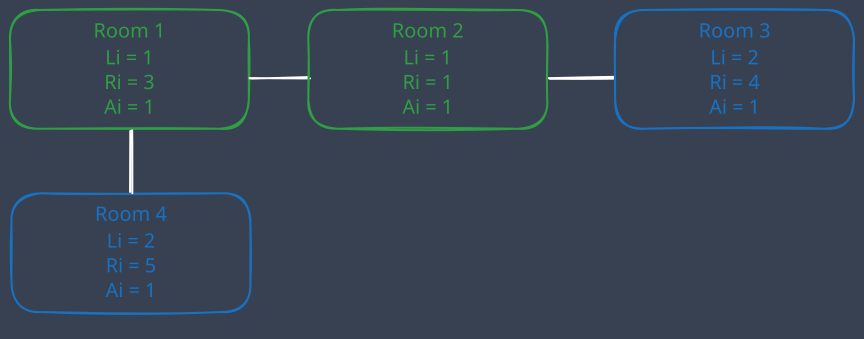

+++
author = "Damian Kuraś"
title = "Graph Travel Solution for Google Kick Start 2021 Round F"
date = 2022-03-02
lastmod = 2024-10-01
description = "Solution for the competitive programming problem 'Graph Travel' from Google Kick Start 2021 Round F. Learn how to combine graph traversal techniques with dynamic programming approach. Solution written in C++."
draft = false
image = "images/graph-travel-cover.jpg"
keywords = "Google Kick Start, Graph Travel, C++, Competitive Programming"
categories = ["Competetive Programing"]
tags = ["C++","Dynamic Programming", "Graph Theory"]
slug = "graph-travel-google-kickstart"
math = true
+++

## Introduction

In this guide, we'll tackle the Graph Travel problem from Google Kick Start 2021 Round F using a dynamic programming approach. The challenge is to calculate how many unique paths Ada can take to collect exactly K magic points while navigating through a graph of rooms. Solving this question during competition was fun and challenging.

## Full problem statement

### Problem

Ada lives in a magic country A, and she is studying at Magic University. Today, Ada wants to collect magic points in a special space.

The space has **N** rooms (0,1,...,N-1). There are **M** corridors connecting the rooms. A corridor j connects room **X<sub>j</sub>** and room **Y<sub>j</sub>** meaning you can travel between the two rooms.

The i-th room contains **A<sub>i</sub>** magic points and is protected by a magic shield with properties **L<sub>i</sub>** and **R<sub>i</sub>** to enter the i-th room, first you need to get to any room adjacent to the i-th room (i.e. connected to it by a corridor) through rooms with already broken shields. Then you have to break the shield to this room. The room will not generate new magic points. The room will also not generate a new shield after it is broken, so you can freely go back to every room with already broken shields regardless of the amount of points you have.

Ada starts with 0 magic points and her goal is to find a way to collect exactly **K** magic points. She can start in any room, and end in any room. The room she chooses to start in will automatically have its magic shield broken and she will automatically collect all the magic points from his room.

After inspecting the map of the rooms and corridors. Ada thinks the task is very easy, so she wants to challenge herself with a more difficult task. She wants to know how many unique ways are there to reach the goal. Two ways are different if their unique paths are different. The unique path is the order of rooms in which she broke the shields, e.g.: if you visit the rooms in the order (1,3,2,1,3,5,3,6), the unique path is (1,3,2,5,6)

### Input

The first line of the input gives the number of test cases **T**. **T** test cases follow.

For each test case, the first line contains three integers **N**,**M** and **K**: the number of rooms, the numbers of corridors, and the numbers of magic points we want to collect respectively.

The next **N** lines contains three integers **L<sub>i</sub>**,**R<sub>i</sub>** and **A<sub>i</sub>**: The magic shield properties **L<sub>i</sub>** and **R<sub>i</sub>** of room i, and the number of magic points **A<sub>i</sub>** respectively.

The next **M** lines contain two integers **X<sub>j</sub>** and **Y<sub>j</sub>**: the rooms that are connected by corridor j.

### Output

For each test case, output one line containing Case #x: y where x is the test case number (starting from 1) and y is the number of ways to collect **K** magic points.

### Limits

Memory limit: 1GB.s

1 ≤ **T** ≤ 100

0 ≤ **M** ≤ $ \frac{n(n-1)}{2} $

0 ≤ **X<sub>j</sub>**, **Y<sub>j</sub>** ≤ **N-1**

**X<sub>j</sub>**≠ **Y<sub>j</sub>**

Each pair of rooms can be connected by at most one corridor.

### Problem statement TLDR

The problem involves **N** rooms connected by **M** corridors. Each room has an associated number of magic points and a shield that requires a specific amount of points to break. Ada can start in any room, collect magic points, and break shields if she has points in the required range. The challenge is to find how many **unique paths** Ada can take to collect **exactly K** magic points.

**Unique paths** differ by the order in which rooms are visited to break their shields. The objective is to compute the number of such paths for each test case.

## Solution approach

A brute force solution would require checking every possible sequence of rooms to collect exactly **K** points, but this would be inefficient O(n!). Instead, we use dynamic programming with DFS to eliminate redundant computations and track state where shields are already broken.

### Key Idea:

Represent the state as a combination of rooms with broken shields and the points collected so far. By memoizing previously computed states, we can skip redundant computations and drastically improve performance.

### Step by step example

We can better understand how dynamic programming helps solve the Graph Travel problem by visualizing an example. Let's consider a setup with 4 rooms:

and requirement to get exactly 3 magic points


**Initial room state**:

- Room 1 and Room 2 are cleared and shown in green (indicating shields are broken).
- Room 3 and Room 4 are unvisited, so they are marked in blue.
  Ada’s goal is to collect exactly 3 magic points. Here’s how the dynamic programming approach helps.

Visualizing Dynamic Programming in Action:

1. Starting at Room 1: Ada has collected 1 magic point already and then one point in room 2. She can visit Room 3 (blue), break its shield (since it's within L=2 and R=4), and collect an additional magic point, giving her a total of 3 points. But she can also visit room to 4 to get the remaining point. There are 2 unique paths to reach 3 points from Room 1.
2. Starting at Room 2: Room 2 has 1 point. Once Ada visits Room 1 we reach again the same state she had after going from room 1 to room 2. She can reuse the previously calculated results from exploring Room 1, adding 2 paths to the total without re-exploring rooms 3 and 4. This reusability is the power of dynamic programming in reducing redundant calculations.

## Step-by-Step Solution Breakdown

1. Graph Representation: The rooms and corridors form a graph. We can traverse this graph to collect points while breaking shields according to the rules.
2. Dynamic Programming: Use dynamic programming to store the number of ways to collect points for different states of the graph. A state is defined by which shields are broken and how many points are collected so far.
3. DFS Traversal: We explore all paths using DFS. Once we hit K magic points, we count it as a valid path.
4. Memoization: To prevent re-exploration of already computed paths, we store results in the DP table for each state.

## Solution in c++

Here’s the full implementation of the solution in C++:

```cpp
#include <bits/stdc++.h>
using namespace std;
static int fast_io = []()
{ std::ios::sync_with_stdio(false);
 cin.tie(nullptr);
 return 0; }();

struct room
{
    int li;
    int ri;
    int points;
};
map<vector<bool>, unsigned long long int> dp;
unsigned long long int dfs(
    vector<bool> &broken,
    unsigned long long int mp,
    vector<vector<int>> &adjacency,
    vector<room> &rooms,
    int n,
    int k)
{
    if (dp.find(broken) != dp.end())
    {
        return dp[broken];
    }
    if (mp == k)
    {
        dp[broken] = 1;
        return 1;
    }
    unsigned long long ans = 0;
    for (int i = 0; i < n; i++)
    { // check if ith room can be broken
        if (!broken[i])
        {
            bool canBeBroken = false;
            if (mp >= rooms[i].li && mp <= rooms[i].ri)
            {
                for (auto x : adjacency[i])
                {
                    if (broken[x])
                    {
                        canBeBroken = true;
                        break;
                    }
                }
            }
            if (canBeBroken)
            {
                broken[i] = true;
                mp += rooms[i].points;
                ans += dfs(broken, mp, adjacency, rooms, n, k);
                mp -= rooms[i].points;
                broken[i] = false;
            }
        }
    }
    dp[broken] = ans;
    return ans;
}
int main()
{
    int T;
    cin >> T;
    for (int c = 1; c <= T; c++)
    {
        int n, m, k;
        cin >> n >> m >> k;
        vector<room> rooms(n);
        for (int i = 0; i < n; i++)
        {
            cin >> rooms[i].li >> rooms[i].ri >> rooms[i].points;
        }
        vector<vector<int>> adjacency(n);
        int a, b;
        for (int i = 0; i < m; i++)
        {
            cin >> a >> b;
            adjacency[a].push_back(b);
            adjacency[b].push_back(a);
        }
        unsigned long long ans = 0;
        for (int i = 0; i < n; i++)
        {
            // collect the number of ways for all starting points
            vector<bool> broken(n);
            broken[i] = true;
            int mp = rooms[i].points;
            ans += dfs(broken, mp, adjacency, rooms, n, k);
        }
        cout << "Case #" << c << ": " << ans << "\n";
        ans = 0;
        dp = {};
    }
    return 0;
}
```

## Conclusion

The Graph Travel problem from Google Kick Start Round F is a great example of how combining graph traversal techniques with dynamic programming can help solve complex optimization problems efficiently.
