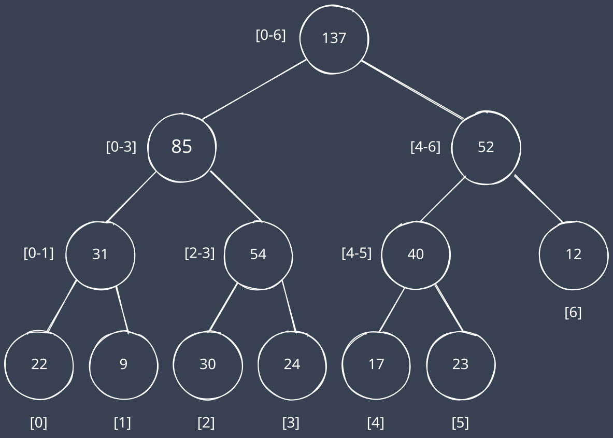
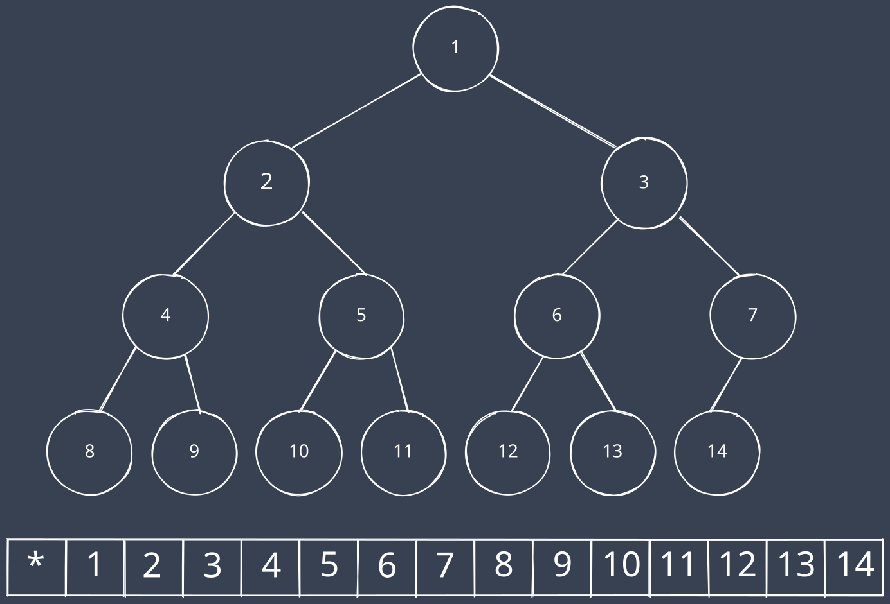
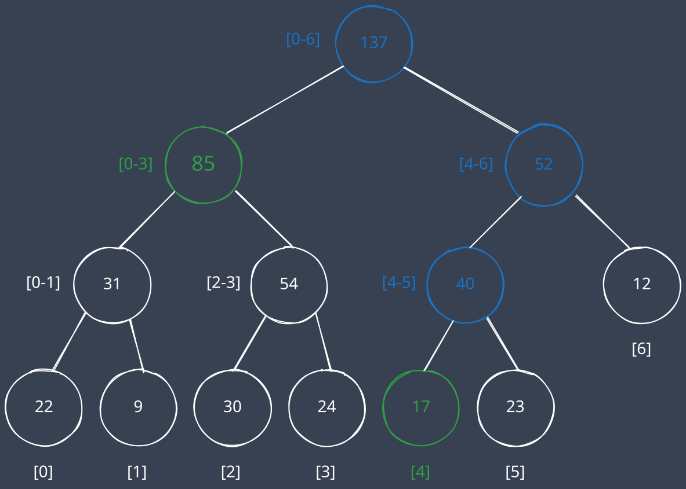
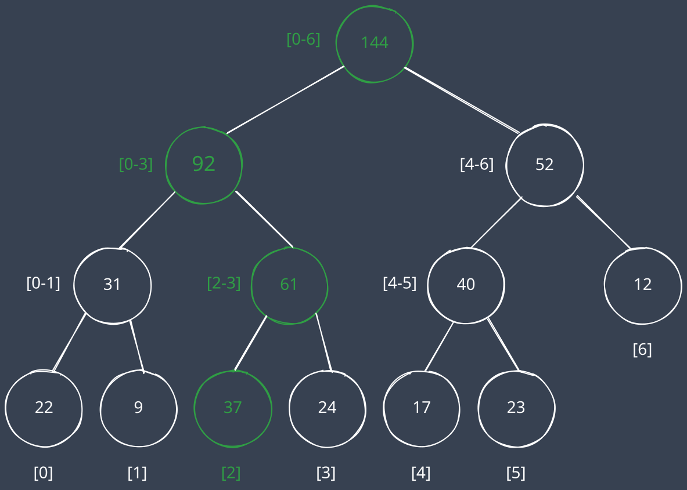
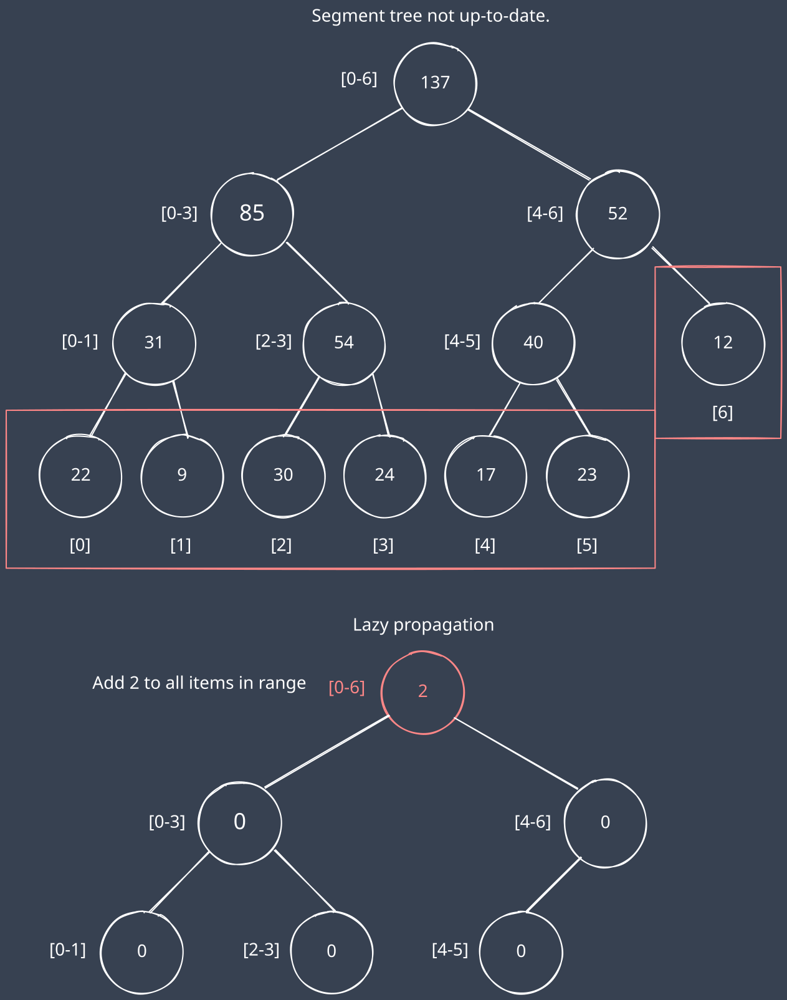
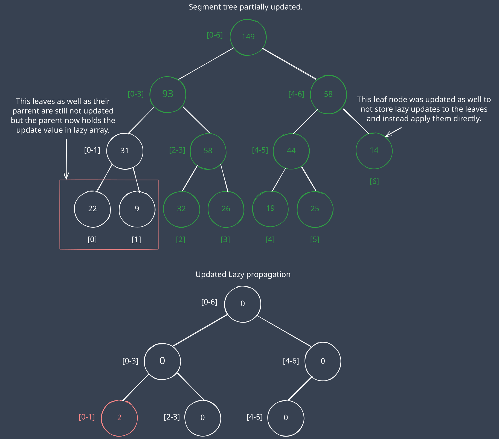

+++
author = "Damian Kuraś"
title = "Segment Tree Explained: Efficient Range Queries & Lazy Propagation in C++"
date = 2022-04-23
lastmod = 2024-10-15
description = "Learn how segment trees work and how to use it for efficient range queries, learn lazy propagation in segment trees for updates, with examples in C++."
draft = false
image = "images/seg-tree.svg"
keywords = "Segment Tree, Range Queries, Lazy Propagation, C++"
categories = ["Data Structures"]
tags = ["Segment Tree","C++"]
slug = "segment-tree"
math = false
+++

## What is a Segment Tree

A segment tree is an interesting data structure that efficiently handles **range queries**. Simple operations like finding the minimum, maximum, or sum over a range can be done in **_O_(log n)** time.



Each leaf node represents an element, while non-leaf nodes store information merged from their child nodes. This structure enables fast querying by utilizing precomputed data. However, it comes at the cost of extra space, typically doubling the size of the array for internal nodes.

## How a Segment Tree Works

### Construction of the Segment Tree

In a range sum segment tree, each leaf represents an array element, and internal nodes store sums of their child intervals. A segment tree can be stored as an array for faster access. Nodes i*2 and i*2+1 are the left and right children of node i.



This arrangement makes it easy to compute parent-child relationships, where the parent of node i is at index i/2 (thanks to the way integer rounding works).

In this setup we need to have root at index 1 as starting with index 0 doesn't work(2\*0=0).

### Example: Querying the Sum of Elements

To query a range sum, we traverse the tree, summing nodes that overlap with the query range. Here's an illustration for querying the sum of the first five elements:



Time complexity of range query is **_O_(log n)**. If you don't understand why time complexity is _O_(log n) you can check out this [article](https://cp-algorithms.com/data_structures/segment_tree.html#sum-queries) to see the proof. In short the tree has height of log(n) and at most four nodes are checked per level.

### Single-Value Updates

Updating a segment tree starts by changing the leaf node, then we need to rebuild the tree to reflect changes to this leaf node by updating all ancestors up to the root:



Time complexity of updating single element is **_O_(log n)**.

### C++ implementation for range sum

```cpp
#include <bits/stdc++.h>
using namespace std;

class SegTree
{
public:
    SegTree(const vector<int> &nums)
    {
        size = nums.size();
        tree.resize(size * 2);

        // Initialize the leaves of the segment tree
        for (int i = 0; i < size; i++)
        {
            tree[size + i] = nums[i];
        }

        // Build the internal nodes of the tree
        for (int i = size - 1; i > 0; i--)
        {
            tree[i] = tree[i * 2] + tree[i * 2 + 1];
        }
    }

    void update(int index, int val)
    {
        index += size; // Adjust the index to point to the leaf node
        tree[index] = val;

        // Update parent nodes
        while (index > 1)
        {
            index /= 2;
            tree[index] = tree[index * 2] + tree[index * 2 + 1];
        }
    }

    int sumRange(int left, int right)
    {

        // Adjust the indices to point to the leaf nodes in the segment tree
        left += size;
        right += size;
        int sum = 0;

        // Sum the range [left, right) this mean left range inclusive and right range exclusive
        while (left < right)
        {
            // If 'left' is odd, it means 'left' is a right child in the tree.
            if (left % 2 == 1)
            {
                sum += tree[left];
                left++;
            }
            // If 'right' is odd, it means 'right-1' is a left child in the tree.
            if (right % 2 == 1)
            {
                right--;
                sum += tree[right];
            }
            /* Move both 'left' and 'right' to their parent nodes
            to continue summing at a higher level.*/
            left /= 2;
            right /= 2;
        }

        return sum;
    }

private:
    vector<int> tree;
    int size;
};
```

Example usage

```cpp
vector<int> nums{1, 14, 200, 5, 10};
SegTree segTree(nums);

cout << "Sum of range [2, 5): " << segTree.sumRange(2, 5) << endl;
//output
//Sum of range [2, 5): 215
```

## Lazy Propagation for Efficient Range Updates

### What is Lazy Propagation?

Lazy propagation is an optimization technique used in segment trees to efficiently handle range updates. Normally, when updating a range, you would need to propagate changes to all affected nodes, which can be costly, especially if multiple updates are applied consecutively.

Lazy propagation defers updates and only applies them when necessary. This reduces redundant operations and can significantly improve performance, particularly when working with large arrays and frequent range updates.

### Key Idea Behind Lazy Propagation

The idea of lazy propagation is simple: instead of immediately updating all nodes in the range, you “mark” nodes as needing an update later. These pending updates are applied when you actually query the affected range, ensuring the segment tree remains correct and efficient.

To implement lazy propagation, you maintain an additional lazy array. This array stores the values of the pending updates that haven't yet been propagated to the tree nodes. When you query or update a node, the updates stored in the lazy array are first applied to ensure the tree is accurate before proceeding with the current operation.

### Lazy Propagation Example

For example, suppose we have a segment tree representing an array with 6 elements. Let's perform a range update where we want to add 2 to every element in the entire array.

Without lazy propagation, we would need to update every leaf node directly, as well as all internal nodes affected by this change, which would require visiting every node. However, with lazy propagation, we can add 2 to the lazy array of the root node. This avoids the need to visit every node immediately and instead defers the update until it’s actually required (when querying or updating a sub-range).

In this example we marked not updated leaves and showed stored data for lazy updates.


Now suppose we want to query the sum of the range [2, 6). First we need to apply the needed changes.

In this example image we marked the updated nodes with green.



After we are done with the updating we can query the sum the same as previously.

### C++ Implementation of Segment Tree with Lazy Updates

```cpp
#include <bits/stdc++.h>
using namespace std;

class SegTreeLazy
{
public:
    SegTreeLazy(const vector<int> &nums)
    {
        size = nums.size();
        tree.resize(size * 2);
        lazy.resize(size); // Only for internal nodes

        // Initialize the leaves of the segment tree
        for (int i = 0; i < size; i++)
        {
            tree[size + i] = nums[i];
        }

        // Build the internal nodes of the tree
        for (int i = size - 1; i > 0; i--)
        {
            tree[i] = tree[i * 2] + tree[i * 2 + 1];
        }
    }

    // Apply a pending update to a node
    void apply(int node, int value, int len)
    {
        tree[node] += value * len; // Apply the value to the node

        if (node < size) // If it's an internal node, mark its lazy value
        {
            lazy[node] += value;
        }
    }

    // Push pending updates down to the children
    void push(int node, int nodeSize)
    {
        for (int shift = __builtin_clz(size) - __builtin_clz(node); shift > 0; --shift)
        {
            int parent = node >> shift;
            int childSize = nodeSize >> (shift - 1);

            if (lazy[parent] != 0) // Push down lazy updates
            {
                apply(parent * 2, lazy[parent], childSize / 2);     // Left child
                apply(parent * 2 + 1, lazy[parent], childSize / 2); // Right child
                lazy[parent] = 0;                                   // Clear the lazy value
            }
        }
    }

    // Adds value to every element in range [left, right)
    void rangeAdd(int left, int right, int value)
    {
        int l = left + size, r = right + size;
        int l0 = l, r0 = r;
        int nodeSize = 1;

        push(l0, nodeSize);
        push(r0 - 1, nodeSize);

        // Apply the addition in the given range
        while (l < r)
        {
            if (l % 2 == 1)
            {
                apply(l, value, nodeSize);
                l++;
            }
            if (r % 2 == 1)
            {
                r--;
                apply(r, value, nodeSize);
            }
            l /= 2;
            r /= 2;
            nodeSize *= 2; // Update node size as we go higher up in the tree
        }

        // Rebuild the affected nodes upwards
        l = l0;
        r = r0 - 1;
        nodeSize = 1;
        while (l > 1)
        {
            l /= 2;
            r /= 2;
            nodeSize *= 2;

            if (lazy[l] == 0)
            {
                tree[l] = tree[l * 2] + tree[l * 2 + 1];
            }

            if (lazy[r] == 0 && l != r)
            {
                tree[r] = tree[r * 2] + tree[r * 2 + 1];
            }
        }
    }

    // Query the sum in the range [left, right)
    int sumRange(int left, int right)
    {
        int l = left + size, r = right + size;
        int sum = 0;
        int nodeSize = 1;

        // Push any pending updates from ancestors to current nodes
        push(l, nodeSize);
        push(r - 1, nodeSize);

        // Sum the range while handling the current nodes
        while (l < r)
        {
            if (l % 2 == 1)
            {
                sum += tree[l];
                l++;
            }
            if (r % 2 == 1)
            {
                r--;
                sum += tree[r];
            }
            l /= 2;
            r /= 2;
        }

        return sum;
    }

private:
    vector<int> tree;
    vector<int> lazy; // Only for internal nodes
    int size;
};
```

Example usage

```cpp
vector<int> nums{1, 14, 200, 5, 10};
SegTreeLazy segTreeLazy(nums);

cout << "Sum of range [2, 5): " << segTreeLazy.sumRange(2, 5) << endl;
segTreeLazy.rangeAdd(2, 5, 10);
cout << "After updating range [2, 5) by adding 10:" << endl;
cout << "Sum of range [2, 5): " << segTreeLazy.sumRange(2, 5) << endl;
cout << "Sum of range [0, 5): " << segTreeLazy.sumRange(0, 5) << endl;
// output
// Sum of range [2, 5): 215
// After updating range [2, 5) by adding 10:
// Sum of range [2, 5): 245
// Sum of range [0, 5): 260
```

## Conclusion

Segment trees with lazy propagation are essential for handling range updates efficiently. By delaying updates and only applying them when necessary, we can reduce the time complexity of range updates while maintaining fast query times.
